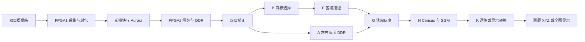

# 双 FPGA 双目视觉与三维定位抓取系统

本提交对应已完成的三模式版本：目标测距与 XYZ、全图深度伪彩、RGB 与深度伪彩融合。FPGA 输出坐标，电脑端 Python 上位机完成坐标转换和机械臂抓放。机械臂不是由 FPGA 独立直接控制；融合显示也不是新视点重建或裸眼立体显示。

FPGA1：XC7A35T-FGG484-2；FPGA2：XC7Z035-FFG900-2。采集双目 OV5640 图像，经光模块/Aurora 传输到 FPGA2。有效图像 1280×720；彩图内存行步长为 1920 个 32 位字，不能按有效宽度推算彩图地址。

标定关系固定为 **RX1=LEFT，RX0=RIGHT，RIGHT_RECT 为参考，d=uR-uL**。算法与坐标计算维持原图坐标，显示写回阶段进行一次上下翻转。完整分支、内存和握手见 [架构与接口](docs/architecture.md)。

## 目录对照

| 本目录 | 对应赛事材料 |
|---|---|
| fpga1_bd、fpga2_bd | src：RTL、HLS、自定义 IP、BD、约束 |
| fpga2_vitis | src：PS 裸机应用、链接脚本、初始化配套 |
| dummy_control_new | src：电脑端机械臂上位机；tests 为离线验证 |
| scripts | build/board：检查、构建、导出、下载入口 |
| calibration | data：左右矫正映射表 |
| data | 历史日志片段与来源说明，不是本次重新上板采样 |
| validation | 复查结果、历史综合和验证证据 |
| skill | 技能包说明及三个可复用技能 |
| report | 协作案例、优化证据和提交缺项；设计报告 PDF 单独提交 |
| third_party | 依赖、原许可证及来源信息 |

## 从哪里开始

1. 使用 Vivado / Vitis / Vitis HLS **2023.2**。本作品沿用经调试的工具版本；并非按 2025.2/2026.1 重新构建的作品。版本差异及复现状态见 [复现指南](docs/reproduction.md)。
2. 解压到短英文路径，例如 `C:/fpga/stereo_vision`。检查源码：`python scripts/check_submission.py --check-manifest`。
3. 根据复现指南依次构建 HLS、两个 Vivado 工程、XSA、Vitis 应用；构建脚本不替代完整重建验证。
4. PC 上位机：`python -m pip install -r dummy_control_new/requirements.txt`，再执行 `python dummy_control_new/main.py`。首次复现先进行离线测试，再连接设备。
5. 查看 [还需补充的材料](report/remaining_items.md)。该清单是当前提交边界，不把历史记录等同于本次新验证。

## 证据与授权状态

[验证说明](validation/README.md)区分本次离线检查、10 月 20 日三模式历史综合和 9 月旧实现报告。性能数据的 ROI 段、完整轮次与 HDMI 刷新率分别统计，不能互相替代。

本次既有上位机109项离线测试中102项通过，7项涉及旧试验目标、偏移或接口期望的差异，详情见[未通过项](validation/python_known_failures.md)。算法与标定源码保持不变；这份归档没有宣称全部测试通过。

本目录保留第三方原始声明；混合来源工程的统一开源许可尚需作者确认，见 [许可状态](docs/license_status.md)。没有以本文件代替第三方授权。

## GitHub提交状态

本仓库采用自定义目录组织，目录对照见上表。report/README.md说明设计报告与系统技术文档的对应关系；最终缺项见report/remaining_items.md。GitHub Actions仅检查归档契约与新增工具，不代表完整硬件验收。

本仓库SOURCE_MANIFEST的文本SHA-256和bytes字段使用Git文本LF规范化后的字节，二进制保持原样；排除被忽略的运行日志、缓存与构建产物。板级下载配置的bit/ELF/映射表哈希始终按原始字节计算。

本地整理不等于远端已更新；提交推送后需检查GitHub网页是否包含skill、report和validation目录。
