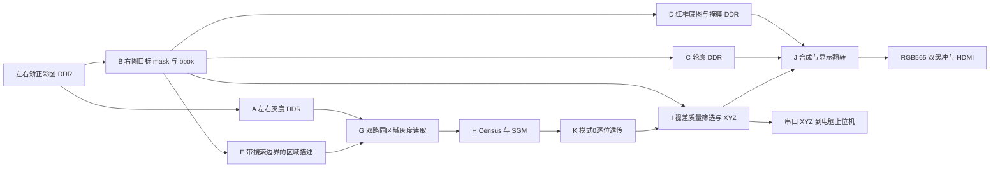

# 架构、接口与三模式边界

## 采集与矫正

两个 OV5640 → FPGA1 初始化、采集、帧编码与发送 → 光模块/Aurora → FPGA2 解码 → 两路 VDMA S2MM 三帧缓冲。RX1 对应标定 LEFT，RX0 对应标定 RIGHT。两路矫正读取受保护的已完成原始帧，使用本目录 calibration 下的映射表，输出左右矫正彩图 DDR。

当前默认 ROI_ARCHITECTURE=1，采用原始缓冲保护与直接矫正，避免 CPU 快照复制与 S2MM 写者竞争。保护的释放以矫正读完为界，不把原始缓冲长期锁到整轮 ROI 计算结束。两路均获得稳定完整帧，不等价于证明双摄曝光严格同时；曝光同步及帧配对精度需实测。

## 模式 0：目标测距

| 模块 | 输入 | 处理与输出 | 下一阶段契约 |
|---|---|---|---|
| A | 左右矫正彩图 | 全图灰度，写两块 DDR | 各 1280×720 字节；灰度行步长 1280 |
| B | RIGHT_RECT 彩图 | HSV、形态学、最大合格连通域，mask+meta | 同帧 bbox、面积、有效标志；mask=0/255 |
| C | B 已完成的 mask | 轮廓邻域计算、行缓存 | 全图轮廓 DDR，与 B 帧号一致 |
| D | 右彩图、B mask/meta | 连续读写、红框底图、掩膜副本 | 供 J 使用；不阻塞 I 的掩膜来源 |
| E | B meta | 简单 bbox+视差搜索及上下文，输出 descriptor | 当前为区域参数，不是全图掩膜或裁剪像素 |
| G | 左右灰度 DDR、descriptor | 对左右图执行同一矩形裁剪，输出两路流 | RIGHT 为 reference，LEFT 为 search；原图起点保留 |
| H | 两路灰度流 | Census+SGM，输出视差流 | 帧大小、行尾、背压与有效像素顺序一致 |
| K | H 视差 | 模式0透传视差与边带 | I 接收的仍是原始语义的视差 |
| I | 视差、B mask、meta | 深度统计、可靠局部样本、XYZ | 使用原图坐标和原有标定；无效结果不得当作新坐标 |
| J | D 底图、C 轮廓、I 结果 | 显示合成、上下翻转、文字叠加 | 完成后切换显示缓冲 |

D 与 G/H/K/I 可以重叠执行。I 读取 **B 的 ROI_WORK_MASK**，避免等待 D 复制完成；J 使用底图前仍需等待 D 完成。测量期间 B mask 不得被下一帧覆盖。I→K→H→G 的消费者优先启动顺序与 AXIS 背压共同保证流管线工作。

深度由视差与标定关系计算，通常写为 Z=fB/d；实际实现还含主点修正与质量阈值，以源码常量为准。毫米 X/Y 必须依赖可靠视差和 Z；不能把提前得到的像素 u/v 直接称作毫米坐标。

## 模式 1/2：全图显示复用

两模式共用 `矫正彩图 DDR → A → 灰度 DDR → G(全图) → H → K → RGB565 显示 DDR`。不启动 B/C/D/E/I/J。模式1做深度伪彩，模式2还读取同轮 RIGHT_RECT 彩图，默认按 7/8 原色、1/8 深度颜色定点混合，无效深度回退原色。不是在 H 后再实例化第二套 SGM，也不把完整图存入 BRAM。

J 用于测距画面，K 用于全图显示；各自写显示 DDR 时完成一次上下翻转。X/Y/Z 保持相机参考系，禁止为显示翻转去更改测量坐标和左右关系。

## 软件与地址

PS 裸机应用负责缓冲保护、缓存一致性、寄存器配置、消费者优先启动、完成轮询、显示切换、日志与串口输出。HLS/RTL 负责像素计算和接口。模块延迟是软件观察的启动至完成时间，含背压和 DDR 等待，不是独占算术时间。

| 配置 | 地址或值 |
|---|---|
| A/B/C/D/E | 0x44000000 / 0x44010000 / 0x44020000 / 0x44030000 / 0x44040000 |
| G/H/I/J/K | 0x44050000 / 0x44060000 / 0x44070000 / 0x44080000 / 0x44090000 |
| UI GPIO | 0x440A0000 |
| 左/右灰度 DDR | 0x10000000 / 0x10200000 |
| B mask / 连通域队列 | 0x10400000 / 0x10800000 |
| meta / descriptor / result | 0x10C00000 / 0x10C00100 / 0x10C00200 |
| D mask / C 轮廓 / D 底图 | 0x11000000 / 0x11200000 / 0x11400000 |
| 有效宽高 / 彩图行步长 | 1280×720 / 1920 个 32 位字 |

地址只是当前提交源码的契约。重新生成 XSA 后须与 Address Editor、xparameters.h 核对；不得把新软件与不匹配的 bitstream 混用。映射表及等待断点地址从本次 ELF 取符号，不能照抄历史绝对地址。

按键为 PL_KEY0/SW4，循环 0→1→2→0，完整帧边界响应；PL_LED0/LED4 仅在测距模式且有效 0<Z≤500mm 时亮。按键和 LED 实际引脚以本目录 dual_mode_ui.xdc 为准。

## 电脑端抓取

FPGA 串口 `XYZ RIGHT_RECT ... valid=1 ... X_mm=... Y_mm=... Z_mm=...` → camera_xyz_parser.py → camera_mode_core.py 稳定筛选 → camera_calibration.json 坐标转换 → camera_pick_place.py / controller.py → PC USB 串口 → Dummy V2。相机串口与机械臂串口是不同端口。现有标定为试验模型，拟合残差不是独立抓取精度，安装变化后必须重新标定。
